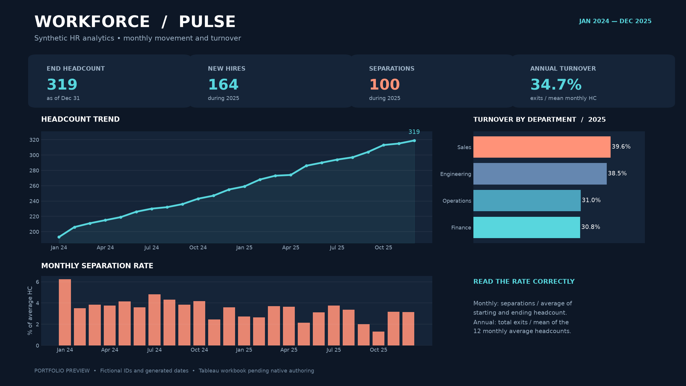

# Workforce Pulse · HR Analytics

An auditable, entirely synthetic employee lifecycle dataset for analyzing headcount and turnover. This project includes clean Tableau-ready CSVs, metric reconciliation, a static dashboard design preview, and an interactive Plotly companion.

**Open the native dashboard:** [hr_analytics.twbx](assets/hr_analytics.twbx) is a Tableau packaged workbook with its data embedded. It contains the **HR analytics dashboard**, **Headcount trend**, and **Turnover by department** sheets. It was created and saved in Tableau Public 2026.2.2. The standalone [workbook source](assets/hr_analytics.twb) is also included; use the packaged file when opening on another computer. No Tableau Public URL has been published. The [PNG preview](assets/dashboard-preview.png) and [offline Plotly preview](assets/dashboard-preview.html) are separate companion assets. The [Tableau build guide](TABLEAU-BUILD-GUIDE.md) documents extensions to the workbook.

## Problem and data

How did the workforce change each month, and which departments had the highest turnover in 2025? The Python script generates fixed-seed, fictional employee IDs and hire/termination dates for four departments and three locations. It contains no names, emails, addresses, or real-person records.

Data flow: **fixed-seed employee ledger → monthly department mart → reconciliation checks → dashboard preview**.

The committed seed-42 dataset contains 526 fictional employee records and 96 month-department metric rows (24 months × 4 departments). The [summary](assets/summary.json) records 319 employees at the end of 2025, 100 separations during 2025, and **34.682081%** annual turnover.

## Run

Requires Python 3.10 or newer. From this directory:

~~~powershell
python -m venv .venv
.\.venv\Scripts\python.exe -m pip install -r requirements.txt
.\.venv\Scripts\python.exe hr_analytics.py --output-dir artifacts --seed 42
.\.venv\Scripts\python.exe -m pytest -q
~~~

On macOS or Linux, use the executable at .venv/bin/python. The HTML preview includes Plotly's JavaScript bundle, so it opens offline.

## Metric definitions

| Metric | Definition |
| --- | --- |
| Start headcount | Employees already hired and active at the start of the month, before that month's new hires. |
| Hires | Hire dates within the calendar month. |
| Separations | Termination dates within the calendar month. |
| End headcount | Start headcount + hires − separations. |
| Average headcount | (Start headcount + end headcount) / 2. |
| Monthly turnover | Separations / average headcount for that month. |
| Annual turnover | Sum of separations for 12 months / mean of the 12 monthly average headcounts. |

The turnover_rate CSV column is a fraction, so format it as a percentage in Tableau. The annual formula uses the complete 12-month numerator and **does not multiply by 12 again**. For a filtered subset of months, label the analogous measure **period turnover**, rather than annual turnover.

## Validation

The validation function recomputes start/end headcount, hires, and separations directly from the employee ledger; checks the balance equation and rate arithmetic; and rejects duplicate or missing month-department rows. Tests also cover a hand-checked 50% turnover example, deterministic generation, lifecycle date consistency, annual denominator semantics, and exported assets.

The data and dashboard are a portfolio demonstration. They are not suitable for personnel decisions.
